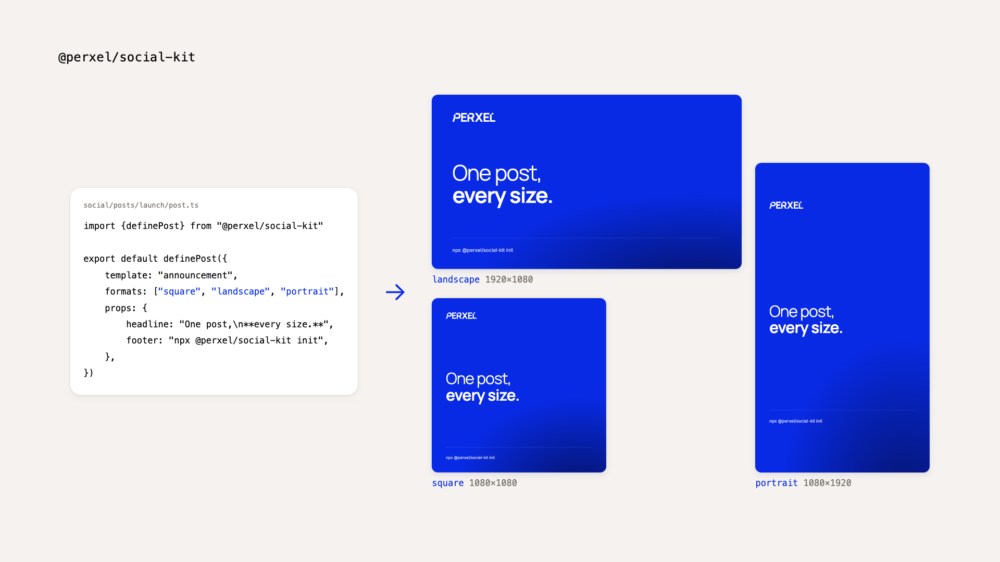

# @perxel/social-kit



One post, every size. Write a post once as a few props, and the kit renders it as a square, a 16:9 and a 9:16 image (or video), plus a contact sheet to review them side by side. Templates are plain React components in your own repo, so they look like your brand, not like ours.

It also makes the images and short clips a site's blog posts need: screenshots and recordings of your live site, and designed images from the same templates, written down as a recipe so one command makes them again when the site changes.

Made by [Perxel](https://perxel.com) for its own posts and blog. MIT licensed.


## Install

```sh
npx @perxel/social-kit init
```

`init` adds the kit as a dev dependency (and React if the project has none), creates `social/` with a config and a first post, adds the kit's work files to `.gitignore`, installs the agent skill with [`npx skills`](https://github.com/vercel-labs/skills) (it asks which agents: Claude Code, Cursor and others) and checks your setup.

By hand:

```sh
pnpm add -D @perxel/social-kit react react-dom
npx skills add perxel/perxel-social-kit --skill social-kit
npx social-kit doctor
```

Update both with `pnpm update @perxel/social-kit && npx skills update`.

**Needs:** Node 22+, React 19 in the project, Chrome for Testing (`npx @puppeteer/browsers install chrome@stable`, or set `CHROME_PATH`). For video and the web presets: ffmpeg; for WebP output: ImageMagick. `social-kit doctor` checks each one and says how to get it.

## Every day

```sh
social-kit new launch-day --template announcement   # social/posts/<date>-launch-day/post.ts
social-kit render launch-day                        # out/launch-day-square.png, -landscape.png, -portrait.png + launch-day-sheet.png
social-kit render launch-day --only portrait
social-kit templates | eject <name> | sheet <post> | doctor
```

A post:

```ts
import {definePost} from "@perxel/social-kit"

export default definePost({
    template: "announcement",
    formats: ["square", "landscape", "portrait"],
    props: {headline: "Something new is **here**."},
})
```

```
social/
  social.config.ts        brand (colours, fonts, logo), extra sizes, defaults
  templates/              your templates (.tsx); one named like a starter replaces it
  assets/                 logos, music, footage
  posts/<date>-<topic>/
    post.ts
    out/                  the rendered files, named after the post: <topic>-<format>.png|mp4
```

## Templates

```tsx
import type {TemplateMeta, TemplateProps} from "@perxel/social-kit"

export const meta: TemplateMeta<{text: string}> = {name: "quote", formats: ["square", "landscape", "portrait"], kind: "still"}

export default function Quote({width, height, format, props, brand, asset}: TemplateProps<{text: string}>) {
    return <div style={{width, height, background: brand.colors?.primary}}>{props.text}</div>
}
```

- Lay the template out per `format`; keep the 9:16 format's top 240 px and bottom 300 px clear (Stories, Reels and TikTok cover them).
- `asset("social/assets/logos/x.svg")` turns a path from the project root into a URL.
- Mark anything still loading with `data-pending`, and put `data-error="message"` on an element to fail the render.
- Images render on the server (React to HTML, then a Chrome screenshot): no bundler and no client code.
- **Client templates** (`bundle: true` in `meta`): for a template that needs code in the browser (a canvas, a Lottie player, your Tailwind classes, path aliases), the kit builds it with Remotion's bundler and renders one frame. Set it up in the config's `bundle` (`css`, `tailwind`, `alias`, `root`).
- **URL mode:** a post with `url` instead of `template` screenshots a page your own app serves, at each size (`{format}`, `{width}`, `{height}` are filled in).

## Reels

A template with `kind: "reel"`, `fps` and `duration` renders to `out/<topic>-<format>.mp4` through [Remotion](https://www.remotion.dev). Reel templates get `frame` and `fps` and may use Remotion's own components (video, audio, sequences, Lottie).

One post can hold a whole campaign: a template with `kind: "both"` draws a still or a reel depending on `mode`, and a post that sets `reel: {formats}` gets both from one `render`:

```ts
export default definePost({
    template: "launch",                                   // kind: "both"
    formats: ["landscape", "square"],                     // the stills
    reel: {formats: ["square", "landscape", "portrait"]}, // and the reel
    props: {headline: "Something new is **here**."},
})
```

```tsx
export default function Launch(p: TemplateProps<Props>) {
    return p.mode === "reel" ? <LaunchReel {...p}/> : <LaunchStill {...p}/>
}
```

Stills render without Remotion, so keep Remotion hooks and components inside the reel branch. Files are named after the post folder without its date (`2026-10-12-launch` → `launch-square.png`, `launch-square.mp4`); set `name` on the post to change it.

```sh
social-kit preview <post> --at 1.5,4,9     # stills at those seconds for every format, without a full render
social-kit music analyze track.mp3         # tempo, beats and loudness per bar → track.beats.json
social-kit voice setup                     # optional: Python 3.12 + Kokoro (needs uv)
social-kit voice make <post>               # the post's voice lines → WAVs at -14 LUFS
```

`beatGrid({bpm, firstBeat})` gives `at(bar, beat)` in seconds and `kick(t)`, a pulse on every beat.

**Remotion's licence:** reels and client templates need `remotion`, `@remotion/bundler` and `@remotion/renderer` in your project. Remotion is free for individuals and for companies of up to 3 people; larger companies need a [Remotion company licence](https://www.remotion.dev/license). Plain image templates never load it.

**Python** is optional and only for `music analyze` (librosa) and `voice` (Kokoro). Reels work without either.

## Visuals for a site's posts

```sh
social-kit visuals build <recipe> [id...] [--origin=<url>]
social-kit visuals status <recipe>          # made? placed in which files? what to provide
social-kit visuals inventory [folder]       # published media and the files that use it
```

A recipe lists a page's visuals: `capture` (a screenshot of a live page or one element), `record` (a short silent MP4 and its poster), `compose` (a template at a size), `provide` (only a person can get it: a dashboard, a login) and `reuse`. Recordings run steps: scroll, wait, move the pointer, click, tap, type, press keys (`Meta+K`). Outputs use web presets: WebP at most 1600 px wide, MP4 at most 1120 px, silent, fast start. Configure where recipes live and where files go in the config's `visuals`.

## For agents

The skill (`skill/SKILL.md`) tells an agent how to use all of this: check the setup, make a post, review the contact sheet before showing it, write templates, plan a reel beat by beat. Install it with `npx skills add perxel/perxel-social-kit --skill social-kit`.

## Licence

MIT. Remotion, used for reels and client templates, has its own licence (above).
